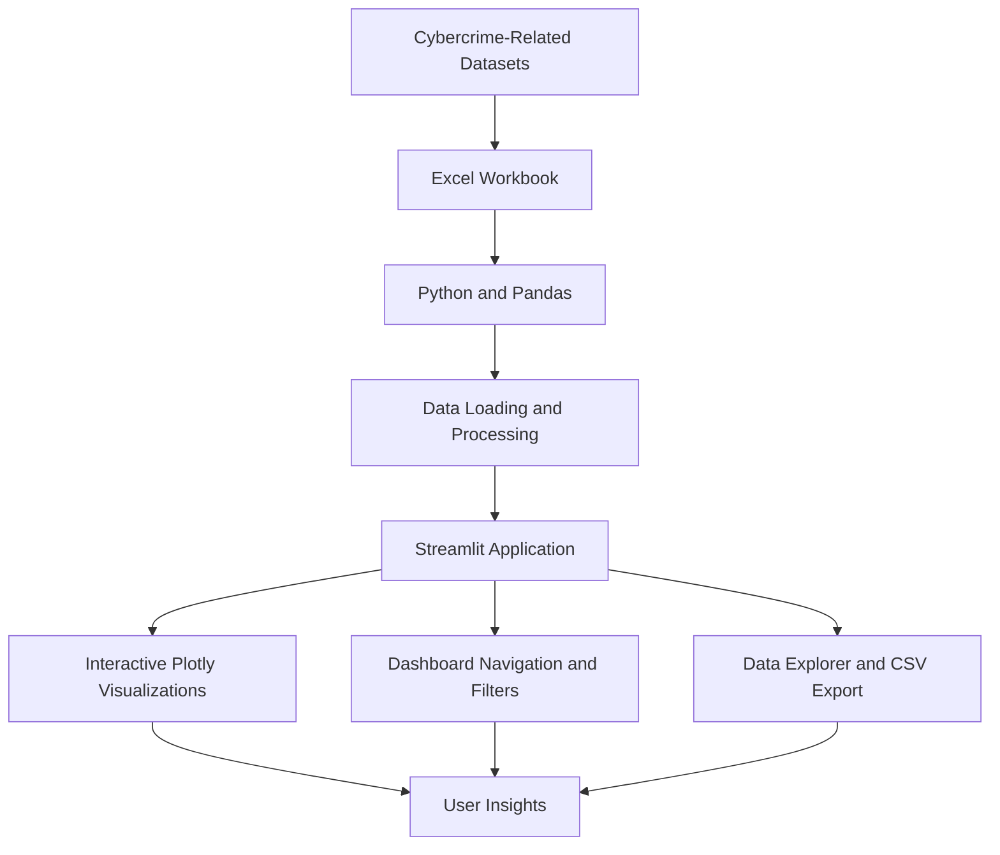

# 🛡️ ScamIntel
### Cybercrime Intelligence & Scam Analytics Platform

## 🌐 Live Application

### 🚀 Explore ScamIntel

**[Open the Live Dashboard →](https://scamintel-kkbqslomkyhgzach73bqhd.streamlit.app/)**

ScamIntel is deployed using Streamlit Community Cloud. Open the application to explore the available dashboards, interact with visualizations, examine data patterns, and use the supported data exploration features.

---

## 📖 Project Overview

Cybercrime and online scams create significant financial and social challenges. Understanding their patterns requires the ability to analyze reported incidents, compare affected groups, explore geographic distributions, and examine documented scam techniques.

**ScamIntel — Scam Intelligence Analytics Platform** is a data analytics project that transforms structured cybercrime-related datasets into an interactive web application.

The platform brings together several categories of information, including reported victim demographics, state-level complaints, financial losses, scam tactic profiles, payment and contact methods, and selected government actions.

Using Python-based data processing and interactive visualizations, ScamIntel makes it easier to explore patterns within the available data without relying exclusively on static spreadsheets or reports.

The application is designed for exploratory analysis, cybersecurity awareness, and data-driven understanding of reported cybercrime.

### 💡 The Problem

Cybercrime datasets often contain information spread across multiple spreadsheets and sources. Extracting useful insights from these datasets can be difficult without appropriate analytical tools and visual representations.

### ✅ The Solution

ScamIntel provides a unified dashboard where users can navigate analytical modules, compare available metrics, explore interactive charts, and inspect supported datasets through a single web interface.

---

## 🎯 Objectives

The primary objectives of ScamIntel are:

- **Analyze cybercrime trends:** Explore reported complaints and financial losses in the available datasets.
- **Understand victim demographics:** Compare reported victim counts and losses across age groups.
- **Explore geographic patterns:** Examine state-level complaint distributions.
- **Investigate scam tactics:** Review documented scam profiles and execution methods.
- **Analyze payment and contact methods:** Explore the information available in the compiled datasets.
- **Examine government responses:** Review selected enforcement actions and reported recovery estimates.
- **Improve data accessibility:** Present spreadsheet-based information through interactive visualizations.
- **Demonstrate practical analytics skills:** Apply data processing, visualization, application development, and cloud deployment techniques.

---

## ✨ Key Features


Explore key indicators and visual summaries derived from the project's available datasets. The dashboard provides a central starting point for examining reported cybercrime patterns and financial losses.


👥 Victim Demographics Analysis</strong></summary>

Analyze reported complaints and financial losses across available age categories. Compare reported impact between groups while keeping the limitations of complaint-based data in mind.


Explore state-level complaint patterns and compare geographic distributions across available years. These comparisons describe reported complaint data and should not automatically be interpreted as population-adjusted risk.

🎭 Scam Tactics Intelligence</strong></summary>

Investigate the manually compiled scam-tactic profiles and examine documented approaches used in the selected sample.

💳 Payment and Contact Analytics</strong></summary>

Explore the available payment-method and contact-method datasets to understand the information recorded about scam transactions and communication channels.


Review selected government actions and reported recovery estimates included in the project workbook. These records represent selected actions rather than a complete account of all enforcement activity.


Inspect supported workbook datasets and export available data to CSV where the application provides that functionality.

</details>

---

## 🧭 Dashboard Modules

| Module | Purpose |
|---|---|
| **Overview** | Presents key indicators and high-level analytical summaries. |
| **Victim Demographics** | Explores reported complaints and losses across age groups. |
| **Geographic Hotspots** | Examines state-level complaint distributions. |
| **Scam Tactics** | Investigates documented scam profiles and tactics. |
| **Payment & Contact** | Explores available payment and contact-method information. |
| **Government Response** | Reviews selected enforcement actions and recovery estimates. |
| **Data Explorer** | Supports dataset inspection and available CSV exports. |

The availability and detail of each analysis depend on the underlying workbook and the data fields implemented in the application.

---

## 🏗️ Application Architecture

ScamIntel follows a straightforward data analytics application workflow.



### Workflow

1. **Data input:** Load the project workbook containing the available datasets.
2. **Data processing:** Use Python and Pandas to read and prepare data for analysis.
3. **Application layer:** Streamlit presents the dashboard modules and user interface.
4. **Visualization layer:** Plotly supports interactive charts and analytical comparisons.
5. **Exploration:** Users interact with the dashboard and inspect supported data.

---

## 🧰 Technology Stack

| Technology | Role in the Project |
|---|---|
| **Python** | Core application logic and data analysis |
| **Streamlit** | Interactive web interface and dashboard navigation |
| **Pandas** | Data loading, transformation, and analysis |
| **Plotly Express** | Interactive data visualizations |
| **OpenPyXL** | Excel workbook reading |
| **HTML and CSS** | Custom interface styling |
| **Git and GitHub** | Source code management |
| **Streamlit Community Cloud** | Hosting and deployment |

---

## 📊 Dataset Overview

The project uses `Data_Matrix_P1.xlsx` as its central workbook.

The workbook includes the following categories of information:

| Dataset Category | Analytical Purpose |
|---|---|
| **FBI IC3 age data** | Examine reported complaints and losses by age group. |
| **FBI IC3 state data** | Explore reported complaints across states. |
| **Scam tactic profiles** | Examine the tactics documented in the compiled sample. |
| **FTC-related payment data** | Explore available payment-method information. |
| **FTC-related contact data** | Examine available contact-channel information. |
| **Selected government actions** | Review selected enforcement actions and recovery estimates. |

### Data Preparation

The application uses Python-based data handling to load the workbook and make available datasets accessible to the dashboard.

The resulting analyses depend on the workbook's contents, field definitions, reporting periods, and completeness.

---

## 📁 Project Structure

```text
ScamIntel/
│
├── app.py
│   └── Main Streamlit application
│
├── requirements.txt
│   └── Python package dependencies
│
├── Data_Matrix_P1.xlsx
│   └── Cybercrime analytics workbook
│
├── README.md
│   └── Project documentation
│
├── .gitignore
│   └── Files excluded from version control
│
└── architecture.png
    └── Optional architecture diagram
```

`architecture.png` is optional. Include it in the repository only if you have saved the architecture diagram under that filename.

---

## ⚙️ Installation and Setup

Follow these steps to run ScamIntel locally.

### Prerequisites

- Python installed on your computer.
- Git installed if cloning the repository.
- The project source files and required Excel workbook.

### Step 1: Clone the Repository

```bash
git clone https://github.com/sourabbh741/ScamIntel.git
cd ScamIntel
```

> If your GitHub repository has a different name, use its actual clone URL from the repository's **Code** menu.

### Step 2: Create a Virtual Environment

```bash
python -m venv .venv
```

### Step 3: Activate the Environment

**Windows PowerShell**

```powershell
.\.venv\Scripts\Activate.ps1
```

**Windows Command Prompt**

```bat
.venv\Scripts\activate.bat
```

### Step 4: Install Dependencies

```bash
python -m pip install -r requirements.txt
```

### Step 5: Start the Application

```bash
python -m streamlit run app.py
```

### Step 6: Open the Dashboard

Navigate to:

**http://localhost:8501**

Keep `Data_Matrix_P1.xlsx` in the location expected by the application. If a worksheet-related error appears, check that the workbook's actual sheet names match those referenced in `app.py`.

---

## ☁️ Deployment

ScamIntel is hosted on **Streamlit Community Cloud**.

### Deployment Workflow

1. Store the application code and required data files in GitHub.
2. Open [Streamlit Community Cloud](https://share.streamlit.io/).
3. Connect the GitHub repository.
4. Select the appropriate branch and `app.py` as the application entry point.
5. Deploy the application.
6. Test the live dashboard after deployment.

### Live Demo

**[🚀 Launch ScamIntel](https://scamintel-kkbqslomkyhgzach73bqhd.streamlit.app/)**

Changes pushed to the connected deployment branch can trigger an application update. Review the deployment logs if a new version fails to start.

---

## 🔍 Analytical Approach

ScamIntel uses exploratory data analysis to make the available cybercrime-related information easier to examine.

The analytical workflow focuses on:

- **Descriptive analysis:** Summarizing reported complaint counts and financial losses.
- **Demographic comparisons:** Comparing reported impacts across age groups.
- **Geographic comparisons:** Examining state-level complaint distributions.
- **Categorical exploration:** Reviewing documented scam tactics, payment methods, and contact channels.
- **Enforcement review:** Examining selected government actions and reported recovery estimates.
- **Interactive visualization:** Using charts and dashboard navigation to explore patterns.

These methods support exploration and comparison. They do not, by themselves, establish causal relationships or predict the likelihood that a particular person will experience a scam.

---

## ⚠️ Data Limitations and Responsible Interpretation

Responsible interpretation is essential when analyzing cybercrime data.

- **Underreporting:** Reported complaints do not include every scam incident.
- **Reporting differences:** Complaint totals may be influenced by reporting behavior and other factors.
- **Geographic interpretation:** State-level counts should not be treated as population-adjusted risk unless suitable population data and calculations are included.
- **Dataset reconciliation:** Age-based and state-based totals may differ because the datasets can have different scopes or definitions. They should be analyzed separately unless their comparability is established.
- **Sample size:** The compiled scam-tactic profiles are limited and are not necessarily representative of all scams.
- **Recovery estimates:** Government action and recovery figures reflect the selected records and the definitions used by their sources.
- **Causality:** Patterns observed in descriptive charts do not prove that one factor causes another.

ScamIntel is intended for exploratory analysis, educational use, and cybersecurity awareness. Its findings should be interpreted in the context of the underlying datasets and their limitations.

---

## 🔮 Future Enhancements

Potential directions for further development include:

- 📅 Expanded year-over-year trend analysis.
- 📍 Population-adjusted geographic comparisons where appropriate data is available.
- 🧹 Additional data validation and quality checks.
- 📚 Broader scam-tactic coverage using documented, verifiable sources.
- 📊 More comparative visualizations and clearer chart annotations.
- ♿ Improved accessibility and mobile responsiveness.
- 🔄 Automated data updates when reliable source data is available.
- 🧪 Automated tests for data loading and dashboard functionality.

These are potential improvements and are not claims about features already implemented.

---

## 👨‍💻 Author

### Sourabh Awasthi

B.Tech — Electronics and Communication Engineering  
Data Analysis Intern — Psyliq

This project demonstrates practical work in data analysis, interactive visualization, Python application development, and cloud deployment.

**Connect and explore:**

- 🌐 **Live Project:** [ScamIntel Dashboard](https://scamintel-kkbqslomkyhgzach73bqhd.streamlit.app/)
- 💻 **GitHub Profile:** [sourabbh741](https://github.com/sourabbh741)
- 💼 **LinkedIn:** [Sourabh Awasthi](https://www.linkedin.com/in/sourabh-awasthi-1684a8359/)

---

## ⭐ Support the Project

If ScamIntel is useful for learning about data analytics or cybersecurity, consider starring the repository on GitHub.

Explore the dashboard, examine the available datasets, and use the findings as a starting point for further investigation.

